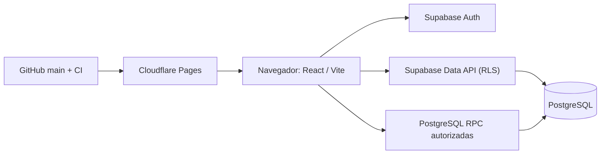

# SGIC-Terneros

**Sistema de Gestión Integral para Crianza de Terneros**. Aplicación web para identificar animales por DIIO, organizar lotes, controlar existencias y consumos, administrar compras y ventas y consultar costos con trazabilidad operativa.

**Aplicación:** https://sgic-terneros.pages.dev/  
**Código:** React, TypeScript y Vite · Supabase Auth, PostgreSQL, Row Level Security (RLS) y funciones SQL · Cloudflare Pages.  
**Idioma de operación:** español · **Moneda:** peso chileno (CLP).

## Funcionalidades

| Área | Capacidades disponibles |
|---|---|
| Resumen | Indicadores de animales activos, lotes, adquisiciones e inventario; acceso a los registros |
| Animales | Registro de compras por DIIO, ingreso en lote, pesajes, rectificaciones, fallecimientos y filtros por estado |
| SIPECweb | Lectura y **comparación sin escritura** de exportaciones SAG `.xls` en XML Spreadsheet 2003 |
| Lotes | Consulta y división de lotes, conservando el origen y las restricciones contables |
| Inventario | Catálogo de productos, presentaciones, conversiones, stock, kardex y costo promedio ponderado (PMP) |
| Compras | Compras de insumos, confirmación inmediata o borrador, detalle por producto/proveedor |
| Alimentación | Planes, composición, asignaciones, consumo real y ejecución desde plan |
| Sanidad | Tratamientos, productos utilizados y costos |
| Ventas y gastos | Ventas por DIIO, borradores de venta, gastos por lote o generales, rentabilidad |
| Solicitudes pendientes | Aprobación o anulación de borradores de **compras de insumos y ventas** |
| Administración | Catálogos, perfiles con roles, auditoría y consultas operativas |

La navegación se organiza en un menú lateral. Las operaciones se abren desde su módulo; no existe una pantalla independiente de operaciones.

## Inicio de sesión y perfiles

Se utiliza Supabase Auth con correo electrónico y contraseña. Cada cuenta nueva recibe un perfil `OPERADOR` inactivo; un `ADMIN` autorizado debe habilitarla. Los permisos se validan también en la base de datos y no solo en la interfaz.

- **ADMIN:** datos maestros, compras, ajustes, ingresos/bajas de animales, gastos, ventas, autorizaciones de usuarios y sincronización SIPECweb de solo lectura.
- **OPERADOR:** pesajes, consumos de alimentación y tratamientos, con acceso a las consultas permitidas.
- El primer administrador se habilita desde SQL Editor según [Configuración inicial](docs/PRODUCTION_SETUP.md).

## Sincronizar con SIPECweb

En **Animales → Sincronizar con SIPECweb**, un administrador puede seleccionar el `.xls` exportado desde la opción *Consulta animales* del SAG.

1. El navegador lee y valida el XML Spreadsheet 2003, incluidos los espacios anómalos de ciertas declaraciones XML generadas por el SAG.
2. Se conservan los DIIO como texto, incluidos los ceros iniciales; se validan encabezados, fechas y duplicados.
3. Se consultan los DIIO registrados en SGIC y se muestran **nuevos**, **ya registrados** y **activos no presentes en el archivo**.
4. Se revisan los resultados con filtros y una tabla de previsualización.

**Estado de la función:** comparación de solo lectura. No se importan animales, no se ejecutan compras y no se actualizan bajas. El archivo se analiza en el navegador; no se almacena en Supabase. No hay conexión automática ni API oficial SAG integrada. Ver [Manual SIPECweb](docs/SIPEC_INTEGRACION.md).

## Arquitectura

- **Frontend:** `frontend/`. La compilación de producción utiliza la URL y la clave pública publishable del proyecto Supabase autorizado; **nunca** una clave `service_role`/`sb_secret_`.
- **Esquema de datos:** `supabase/migrations/`, 14 migraciones secuenciales versionadas; las tablas de dominio cuentan con RLS.
- **Integridad:** restricciones relacionales, DIIO único, kardex firmado, transacciones atómicas y funciones de autorización.
- **Backend Django:** código legado conservado como referencia; no se ejecuta en Cloudflare Pages.

## Desarrollo local

Requisitos: Node.js 22 y npm.

1. Clonar el repositorio y acceder a `frontend/`.
2. Ejecutar `npm ci`.
3. Copiar `frontend/.env.example` a `frontend/.env.local` y configurar exclusivamente valores públicos del proyecto permitido.
4. Ejecutar `npm run dev`.
5. Validar con `npm run test:sipec` y `npm run build`.

**No introducir datos operativos reales en entornos locales no controlados.** El build de producción utiliza la configuración fija de `frontend/src/api/supabase.ts`; para cambiar de proyecto se debe revisar expresamente ese archivo y desplegar la modificación.

## Despliegue y verificaciones

- Cloudflare Pages: raíz `frontend`; comando `npm ci && npm run build`; directorio de salida `dist`.
- La publicación utiliza la rama `main`; `frontend/public/_redirects` permite navegación SPA.
- GitHub Actions ejecuta pruebas del lector SIPEC, compilación TypeScript/Vite y `npm audit --omit=dev --audit-level=high`.
- El resultado de CI no sustituye la revisión funcional con una cuenta autorizada.

## Documentación

- [Manual de operación y reglas de negocio](docs/OPERACIONES_SUPABASE.md)
- [Arquitectura y despliegue](docs/CLOUD_MIGRATION.md)
- [Instalación y alta de usuarios](docs/PRODUCTION_SETUP.md)
- [SIPECweb: formato y conciliación](docs/SIPEC_INTEGRACION.md)
- [Control de calidad, recuperación y continuidad](docs/PRODUCTION_READINESS.md)
- [Esquema SQL y administración Supabase](supabase/README.md)
- [Especificación funcional original v1.5, solo referencia](docs/SGIC_Terneros_Documentacion_Completa_v1.5.md)

**Estado del módulo SIPECweb:** vista previa implementada; incorporación definitiva desde exportación y sincronización automática con SAG **no implementadas**.
