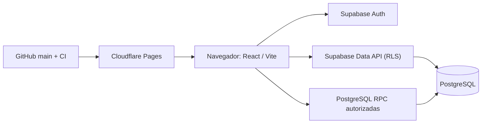

# SGIC-Terneros

**Sistema de Gestión Integral para Crianza de Terneros**. Aplicación web para identificar animales por DIIO, organizar lotes, controlar existencias y consumos, administrar compras y ventas y consultar costos con trazabilidad operativa.

**Aplicación:** https://sgic-terneros.pages.dev/  
**Código:** React, TypeScript y Vite · Supabase Auth, PostgreSQL, Row Level Security (RLS) y funciones SQL · Cloudflare Pages.  
**Idioma de operación:** español · **Moneda:** peso chileno (CLP).

## Funcionalidades

| Área | Capacidades disponibles |
|---|---|
| Resumen | Indicadores de animales activos, lotes, valor base de ganado e inventario; acceso a los registros |
| Animales | Registro de compras por DIIO, ingreso en lote, pesajes, rectificaciones, fallecimientos y filtros por estado |
| SIPECweb | Conciliación de XLS del SAG e **incorporación supervisada** con tipo de ingreso, raza, lote y valor individual |
| Lotes | Consulta y división de lotes, conservando el origen y las restricciones contables |
| Inventario | Catálogo de productos, presentaciones, conversiones, stock, kardex y costo promedio ponderado (PMP) |
| Compras | Compras de insumos, confirmación inmediata o borrador, detalle por producto/proveedor |
| Alimentación | Planes, composición, asignaciones, consumo real y ejecución desde plan |
| Sanidad | Tratamientos, productos utilizados y costos |
| Ventas y gastos | Venta estándar, **venta con precio individual por DIIO**, borradores, gastos y rentabilidad |
| Solicitudes pendientes | Aprobación o anulación de borradores de **compras de insumos y ventas** |
| Administración | Catálogos, perfiles con roles, auditoría y consultas operativas |

La navegación se organiza en un menú lateral. Las operaciones se abren desde su módulo; no existe una pantalla independiente de operaciones.

## Inicio de sesión y perfiles

Se utiliza Supabase Auth con correo electrónico y contraseña. Cada cuenta nueva recibe un perfil `OPERADOR` inactivo; un `ADMIN` autorizado debe habilitarla. Los permisos se validan también en la base de datos y no solo en la interfaz.

- **ADMIN:** datos maestros, compras, ajustes, ingresos/bajas de animales, gastos, ventas, autorizaciones de usuarios, conciliación e incorporación supervisada desde SIPECweb.
- **OPERADOR:** pesajes, consumos de alimentación y tratamientos, con acceso a las consultas permitidas.
- El primer administrador se habilita desde SQL Editor según [Configuración inicial](docs/PRODUCTION_SETUP.md).

## Navegación

Los módulos, fichas y formularios tienen su propia URL. **Atrás** y **Adelante** recorren las vistas visitadas; recargar conserva el módulo, la ficha y los filtros. La búsqueda actualiza la URL sin crear un paso por cada letra. Al llegar al comienzo del historial de SGIC, Atrás conserva su comportamiento normal y puede volver al sitio anterior. Los valores de formularios no enviados no se guardan al navegar.

## Consultar y gestionar un ternero

- En **Animales**, escribe parte del DIIO, raza o lote para filtrar los registros. Pulsa el DIIO para abrir su ficha individual con identificación, fechas, valor base, peso inicial y observaciones.
- Un administrador puede usar **Marcar como fallecido** desde la ficha. El animal queda seleccionado: solo se completa la causa y se confirma el DIIO del resumen. La ficha conserva el estado actualizado y la operación descuenta el conteo del lote.
- Los formularios de pesaje, tratamiento, fallecimiento y rectificación permiten escribir parte del DIIO y elegir una coincidencia con raza, lote y valor base. Escribir por sí solo no selecciona un animal.
- En **Dividir lote**, cada animal muestra raza y valor base. La búsqueda conserva las selecciones; cambiar el lote de origen las limpia. Los animales marcados se muestran por separado y pueden quitarse sin buscarlos de nuevo.

## Sincronizar e incorporar animales desde SIPECweb

En **Animales → Sincronizar con SIPECweb**, un administrador carga el `.xls` exportado por SAG desde la consulta de animales presentes.

1. El navegador interpreta el XML Spreadsheet 2003, conservando los ceros iniciales de cada DIIO.
2. La pantalla compara DIIO **nuevos**, **ya registrados** y **ausentes de la exportación**, sin realizar cambios.
3. Para incorporar nuevos DIIO, seleccionar **Continuar: completar valores y guardar**.
4. Elegir tipo de ingreso: **compra, existencia inicial, traslado o nacimiento**.
5. Seleccionar el lote o crear uno nuevo, registrar fecha, documento opcional y proveedor cuando corresponda.
6. Homologar razas SAG con el catálogo y editar el valor económico de cada animal; se puede aplicar un importe común o pegar una columna de Excel.
7. Revisar el valor total y confirmar explícitamente. La operación es **atómica** y rechaza DIIO duplicados.

**Contabilidad:** el sistema genera un documento de compra únicamente cuando el tipo de ingreso es **Compra**. Para existencia inicial, traslado y nacimiento registra el valor base sin inventar una compra. Todos los animales requieren valor positivo para confirmar: no se guarda precio desconocido como cero.

En **Ventas → Venta con precios por DIIO**, el administrador puede seleccionar animales activos y asignar importes individuales. La venta guarda esos precios y calcula ingreso y utilidad por lote respetando las reglas contables.

La exportación XLS se procesa en el navegador; solo se envían a Supabase los DIIO seleccionados y los datos confirmados para su incorporación. No existe sincronización automática ni API SAG integrada. Consultar [Manual SIPECweb](docs/SIPEC_INTEGRACION.md).

## Arquitectura

- **Frontend:** `frontend/`. La compilación de producción utiliza la URL y la clave pública publishable del proyecto Supabase autorizado; **nunca** una clave `service_role`/`sb_secret_`.
- **Esquema de datos:** `supabase/migrations/`, 15 migraciones secuenciales versionadas; las tablas de dominio cuentan con RLS.
- **Integridad:** restricciones relacionales, DIIO único, kardex firmado, transacciones atómicas y funciones de autorización.
- **Backend Django:** código legado conservado como referencia; no se ejecuta en Cloudflare Pages.

## Desarrollo local

Requisitos: Node.js 22 y npm.

1. Clonar el repositorio y acceder a `frontend/`.
2. Ejecutar `npm ci`.
3. Copiar `frontend/.env.example` a `frontend/.env.local` y configurar exclusivamente valores públicos del proyecto permitido.
4. Ejecutar `npm run dev`.
5. Validar con `npm run test:sipec` y `npm run build`.

**No introducir datos operativos reales en entornos locales no controlados.** El build de producción utiliza la configuración fija de `frontend/src/api/supabase.ts`; para cambiar de proyecto se debe revisar expresamente ese archivo y desplegar la modificación.

## Despliegue y verificaciones

- Cloudflare Pages: raíz `frontend`; comando `npm ci && npm run build`; directorio de salida `dist`.
- La publicación utiliza la rama `main`; `frontend/public/_redirects` permite navegación SPA.
- GitHub Actions ejecuta pruebas del lector SIPEC, compilación TypeScript/Vite y `npm audit --omit=dev --audit-level=high`.
- El resultado de CI no sustituye la revisión funcional con una cuenta autorizada.

## Documentación

- [Manual de operación y reglas de negocio](docs/OPERACIONES_SUPABASE.md)
- [Arquitectura y despliegue](docs/CLOUD_MIGRATION.md)
- [Instalación y alta de usuarios](docs/PRODUCTION_SETUP.md)
- [SIPECweb: formato y conciliación](docs/SIPEC_INTEGRACION.md)
- [Control de calidad, recuperación y continuidad](docs/PRODUCTION_READINESS.md)
- [Esquema SQL y administración Supabase](supabase/README.md)
- [Especificación funcional original v1.5, solo referencia](docs/SGIC_Terneros_Documentacion_Completa_v1.5.md)

**Estado del módulo SIPECweb:** conciliación e incorporación confirmada con valorización individual implementadas. La interoperabilidad automática con SAG no está implementada.
