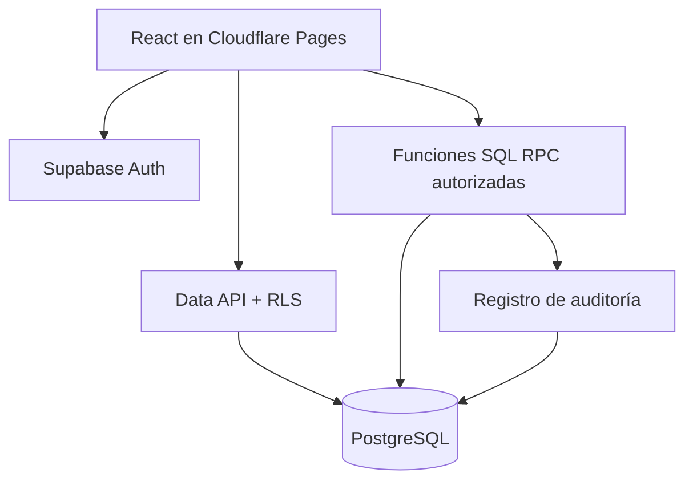

# Arquitectura objetivo y secuencia de migración

**Estado (12/10/2026):** React/Vite publicado en Cloudflare Pages, Supabase Auth/PostgreSQL/RLS integrados y módulos centrales implementados con RPC SQL transaccionales. En operación DEMO; no apto aún para datos empresariales reales sin auditoría de seguridad, pruebas E2E y restauración.

## Componentes

- GitHub: código fuente, pull requests y revisiones.
- Cloudflare Pages: publicación del frontend React/Vite en `frontend/dist`.
- Supabase Free: PostgreSQL, Auth, RLS, Storage y funciones transaccionales.
- Django: referencia de reglas actuales durante la transición; no ejecutable en Pages.

## Flujo de datos implementado

## Configuración de Cloudflare Pages

1. Despliegue ya vinculado a GitHub en `main`: https://sgic-terneros.pages.dev/.
2. Root directory: `frontend`.
3. Build command: `npm ci && npm run build`.
4. Build output directory: `dist`.
5. Definir `VITE_AUTH_PROVIDER=supabase`, `VITE_SUPABASE_URL` y la clave pública `VITE_SUPABASE_PUBLISHABLE_KEY`. No configurar variables privilegiadas.
6. El archivo `frontend/public/_redirects` cubre rutas de React Router en Cloudflare Pages.
7. En modo Supabase, las pantallas operacionales utilizan RPC auditadas y lectura protegida. Las pantallas Django históricas continúan solo en modo de desarrollo Django local.

## Plan de evolución (fases ejecutadas y pendientes)

1. Inventario: exportar contratos Django, modelos y reglas actuales; definir invariantes de DIIO, stock, PMP y costos.
2. Datos: crear migraciones versionadas en `supabase/migrations`; restricciones SQL, FK, índices y política RLS deny-by-default.
3. Identidad: integrar Supabase Auth y autorización por roles verificados del servidor.
4. **Implementado:** RPC transaccionales de compras, ganadería, stock/PMP, alimentación, sanidad, gastos, ventas con DIIO explícitos, roles y auditoría; pendientes pruebas de concurrencia real y política de reversión.
5. **Implementado:** portal cloud React conectado a Supabase para consultas, formularios transaccionales, historial, reportes y usuarios; la implementación Django se conserva aislada como legado.
6. Calidad: pruebas RLS, privilegios, integridad, reversas y conflictos concurrentes; pruebas visuales y responsivas.
7. Operación: exportaciones cifradas, restauración ensayada, pausas del plan Free, monitoreo y decisión de continuidad.

## Criterios de liberación

- Prohibido acceder a tablas empresariales sin sesión y sin RLS.
- La clave `service_role` nunca se expone en el navegador.
- Todo movimiento de inventario genera movimiento y auditoría en la misma transacción.
- Una venta confirmada reconoce costos una sola vez y registra DIIO explícitos.
- Pruebas de restauración documentadas antes de cargar datos empresariales reales.

**Manual de arquitectura:** [Notion](https://app.notion.com/p/3f7b5e350d7181f5957df2b6c8b54634).

## Identidades y permisos implementados

- Trigger privado crea perfil de cada usuario Auth con rol `OPERADOR` e `activo=false`.
- Un administrador habilita usuarios de forma controlada desde SQL Editor; ninguna clave secreta se publica en React.
- Cambios de rol/estado generan auditoría y solo el perfil propio es visible por RLS.
- React usa el SDK oficial de Supabase con versión bloqueada; ingreso con correo/contraseña, validación de sesión y perfil. Las rutas empresariales Django quedan excluidas del modo Supabase.
- Ver [procedimiento operativo](../supabase/README.md) para alta de administrador e instrucciones de validación.

## Manual actualizado

Consultar [procesos operativos, límites y pruebas](./OPERACIONES_SUPABASE.md). No confundir una compilación correcta con pruebas E2E autenticadas ni con certificación para datos empresariales reales.
