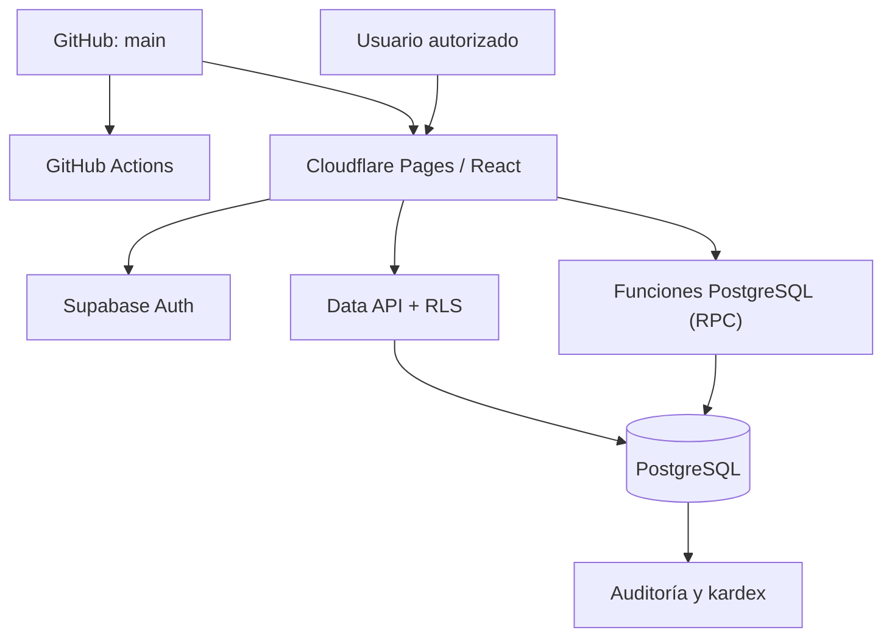

# Arquitectura, despliegue y mantenimiento

## 1. Plataforma vigente

SGIC-Terneros funciona con frontend React/TypeScript/Vite en Cloudflare Pages y backend gestionado Supabase: Auth, PostgreSQL, Data API, RLS y funciones SQL RPC. No requiere servidor Django en el entorno cloud.

- **Repositorio:** https://github.com/MaThUZiB/SGIC-Terneros
- **Aplicación:** https://sgic-terneros.pages.dev/
- **Proyecto Supabase operativo:** `mtecrgoyrfclnlctenss`, región `sa-east-1`.
- **Rama de publicación:** `main`.
- **Migraciones:** 14 archivos de `supabase/migrations/`, ejecutados en orden de versión.

Las peticiones de lectura autorizadas utilizan Supabase Data API; las operaciones que mutan datos empresariales se realizan por RPC SQL. El cliente nunca incorpora claves privilegiadas.

## 2. Desarrollo local

1. Instalar Node.js 22 y npm.
2. Ejecutar `cd frontend` y `npm ci`.
3. Crear `frontend/.env.local` desde `frontend/.env.example`.
4. Configurar `VITE_AUTH_PROVIDER=supabase`, `VITE_SUPABASE_URL` y `VITE_SUPABASE_PUBLISHABLE_KEY` **solo con valores públicos** del proyecto autorizado.
5. Ejecutar `npm run dev` y abrir la URL indicada por Vite.
6. Antes de publicar, ejecutar `npm run test:sipec`, `npm run build` y `npm audit --omit=dev --audit-level=high`.

## 3. Despliegue Cloudflare Pages

1. Vincular el repositorio GitHub y seleccionar la rama `main`.
2. Usar directorio raíz `frontend`.
3. Configurar comando de construcción `npm ci && npm run build`.
4. Configurar salida `dist`.
5. Comprobar `frontend/public/_redirects` para navegación directa a rutas internas.
6. Verificar la publicación, el inicio de sesión y la carga de módulos con un usuario autorizado.

**Configuración actual:** el build de producción de `frontend/src/api/supabase.ts` selecciona la URL y la clave `sb_publishable_` del proyecto productivo. En producción ignora variables `VITE_SUPABASE_URL` y `VITE_SUPABASE_PUBLISHABLE_KEY` definidas en Cloudflare. Para cambiar de instancia o rotar clave, revisar el código y generar un nuevo despliegue; las variables de Cloudflare deben mantenerse documentadas para evitar confusiones, pero no alteran el destino compilado actual.

## 4. Base de datos y migraciones

1. Preparar el proyecto Supabase con Auth y PostgreSQL.
2. Aplicar exclusivamente los archivos SQL de `supabase/migrations/` en orden, mediante procedimiento de migración verificado.
3. No ejecutar `supabase/seeds/demo_20261012.sql` en una base con información operativa.
4. Comprobar tablas, claves foráneas, índices, RLS, funciones RPC y permisos.
5. Crear usuarios con Supabase Auth; verificar la existencia del perfil inicial y habilitarlos por un administrador.
6. Ejecutar consultas de control de stock, compras y lotes desde `supabase/tests/integrity_audit.sql`, sin alterar información.

**Esquema e histórico de migraciones:** los archivos SQL constituyen la fuente versionada; no modificar tablas manualmente en producción sin documentar la migración correspondiente.

## 5. Mantenimiento

- Gestionar nuevas funcionalidades en ramas y fusionar a `main` después de revisión y CI.
- Mantener claves secretas y credenciales de base de datos fuera del repositorio y del frontend.
- Verificar permisos y políticas RLS al incorporar tablas o funciones.
- Mantener copias cifradas exportadas periódicamente y comprobar restauraciones.
- Revisar límites y disponibilidad del plan Supabase Free en el panel oficial.
- El módulo SIPECweb compara archivos XML Spreadsheet 2003 en el navegador; no existe sincronización desatendida con SIPECweb.

Más información: [alta inicial](./PRODUCTION_SETUP.md), [operaciones](./OPERACIONES_SUPABASE.md), [verificaciones](./PRODUCTION_READINESS.md) y [SIPECweb](./SIPEC_INTEGRACION.md).
